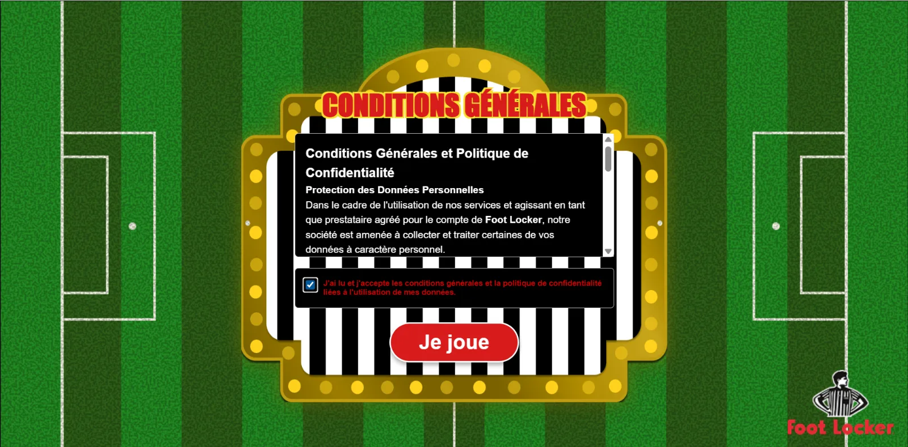
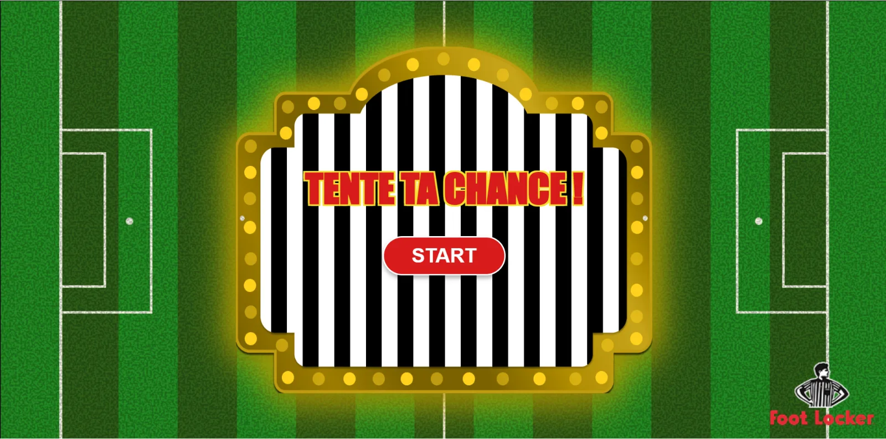
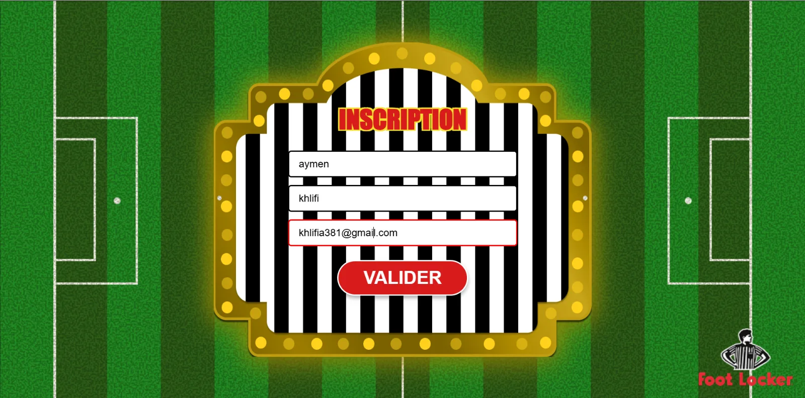
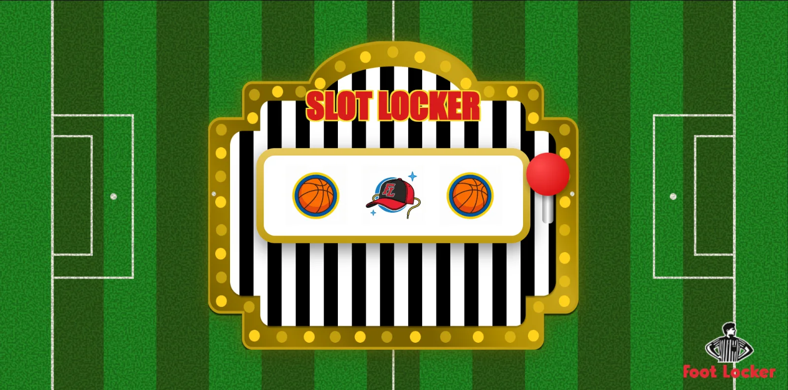

Personne n'a envie de remplir un formulaire. Par contre, tout le monde veut tirer le levier d'une machine à sous. On a donc transformé la collecte de contacts pour **Foot Locker** en mini-jeu, en gardant **le consentement en premier**.

Projet de groupe de 1re année à HETIC, par **Aymen Khlifi, Racha Bouajila et Louis Nourry**.

**Étude de cas :** [portfolio-ay-kh.netlify.app/project-footlocker](https://portfolio-ay-kh.netlify.app/project-footlocker.html)

## Le parcours en 5 écrans

| | Écran | Fichier | Ce qui s'y passe |
|:-:|---|---|---|
| 1 | Conditions | `conditions.html` | On lit et on coche. Sans la case, on ne joue pas. |
| 2 | Accueil | `page1.html` | « Tente ta chance ! » et un bouton START. |
| 3 | Inscription | `page2.html` | Nom, prénom, email. Rien de plus. |
| 4 | Slot Locker | `page3.html` | Trois rouleaux et un levier animé. |
| 5 | Résultat | `page_win.html`, `page_lose.html` | Gagné ou perdu, avec un bouton pour rejouer. |

  
  
  
  

## Lancer le projet

Aucune installation : ouvre `FootLocker-Game-HETIC/conditions.html` dans ton navigateur.

## Technologies

HTML5, CSS3 et JavaScript, sans framework.
